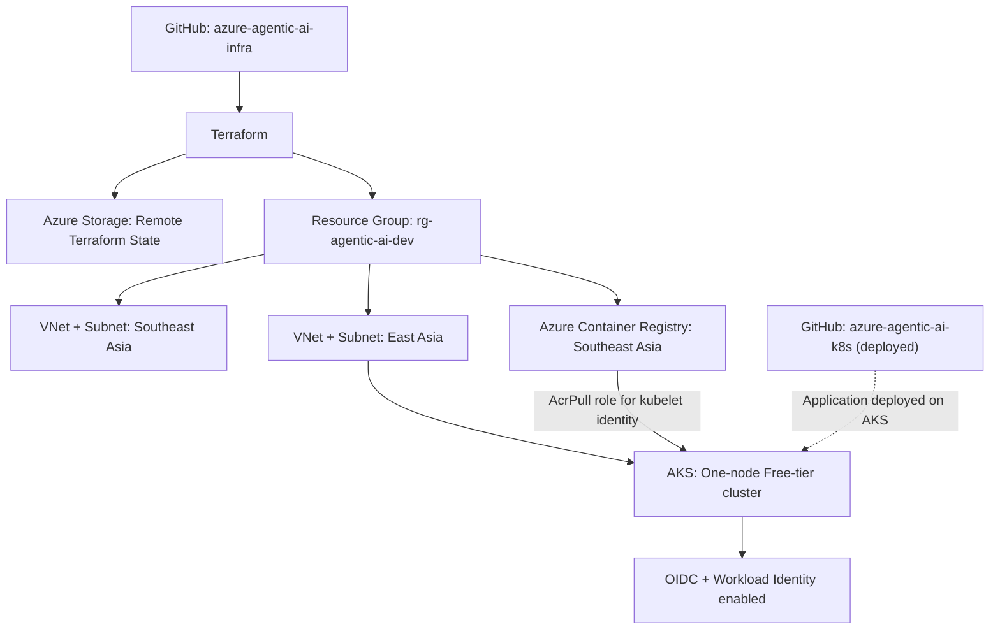

# Azure Agentic AI CloudOps Assistant — Infrastructure

Infrastructure as Code for an Azure-hosted **Agentic AI CloudOps Assistant**. This repository provisions the Azure foundation for a deployed Python/FastAPI and LangGraph-based CloudOps assistant that discovers Kubernetes workloads, collects diagnostic evidence, and supports AI-assisted troubleshooting through Microsoft Foundry.

> **Project status:** Terraform-managed Azure infrastructure and the CloudOps AI Agent v0.2.0 are deployed on AKS. Kubernetes namespace/pod discovery APIs, GUI dropdowns, and read-only RBAC have been verified. The application source and Kubernetes manifests are maintained in [azure-agentic-ai-k8s](https://github.com/jeresel/azure-agentic-ai-k8s).

## Project objectives

- Build a reproducible Azure platform using modular Terraform.
- Deploy a small, cost-conscious Azure Kubernetes Service (AKS) cluster for a short-lived proof of concept.
- Use Azure Container Registry (ACR) with managed identity-based image pulling rather than registry admin credentials.
- Enable AKS OIDC issuer and Microsoft Entra Workload Identity for future application authentication.
- Run a CloudOps assistant that collects Kubernetes diagnostic evidence using read-only API access and integrates LangGraph with Microsoft Foundry.
- Keep infrastructure and application delivery in separate GitHub repositories.

## Architecture



**Regional design:** Initial networking and ACR were provisioned in **Southeast Asia**. The AKS cluster and its dedicated network were provisioned in **East Asia** because the desired general-purpose VM SKUs were restricted for this subscription in Southeast Asia. ACR remains in Southeast Asia; AKS accesses it using an `AcrPull` role assignment.

## Technology stack

| Layer | Technology |
|---|---|
| Cloud | Microsoft Azure |
| Infrastructure as Code | Terraform, AzureRM provider |
| State management | Azure Storage Blob backend, Microsoft Entra authentication |
| Container orchestration | Azure Kubernetes Service (AKS) |
| Container registry | Azure Container Registry (ACR) |
| Networking | Azure VNet, subnet, Azure CNI Overlay, Cilium |
| Identity | AKS managed identity, OIDC issuer, Microsoft Entra Workload Identity |
| Developer tooling | Azure CLI, Terraform CLI, kubectl |
| Observability design | Azure Monitor, Event Hub, Elastic, checkpoint storage |
| Private connectivity | Azure Private Link, Private Endpoints, Private DNS |
| Deployed application | Python, FastAPI, LangGraph, Microsoft Foundry integration, CloudOps Web GUI |

## Repository layout

```text
Azure Agentic AI CloudOps Platform
│
├── azure-agentic-ai-infra
│   ├── Terraform Remote State
│   ├── Azure Networking
│   ├── Azure Kubernetes Service
│   ├── Azure Container Registry
│   ├── Microsoft Foundry Infrastructure
│   ├── Azure Monitor Diagnostics
│   ├── Event Hub
│   ├── Elastic Checkpoint Storage
│   ├── Key Vault
│   ├── Private Endpoint / Private DNS
│   └── Workload Identity
│
└── azure-agentic-ai-k8s
    ├── FastAPI Backend
    ├── CloudOps Web GUI
    ├── LangGraph Agent
    ├── Kubernetes Diagnostics
    ├── Microsoft Foundry Integration
    └── Kubernetes Deployment Manifests
```

The precise Terraform filenames and module inputs are defined in the repository source. The examples below illustrate the workflow rather than replacing the checked-in configuration.

## Infrastructure deployed

| Resource | Configuration |
|---|---|
| Development resource group | `rg-agentic-ai-dev` |
| Original VNet | `vnet-agentic-ai-dev`, `xxxxx/16`, Southeast Asia |
| Original AKS subnet | `snet-aks-dev`, `xxxx/24` |
| Container registry | `acragenticaidevxxx`, Southeast Asia |
| AKS VNet | `vnet-agentic-ai-aks-dev`, `xxxx/16`, East Asia |
| AKS subnet | `snet-aks-eastasia-dev`, `xxxx/24` |
| AKS cluster | `aks-agentic-ai-dev`, East Asia |
| Node pool | One `Standard_D2as_v5` node (2 vCPU, 8 GiB RAM) |
| AKS control-plane tier | Free |
| Network data plane | Azure CNI Overlay with Cilium |
| Identity | System-assigned cluster identity, OIDC issuer, Workload Identity enabled |
| Registry permissions | `AcrPull` assigned to AKS kubelet identity |

### Terraform state backend

A separate bootstrap configuration created the remote state resources:

- Resource group: `rg-agentic-ai-tfstate`
- Storage account: `stagenticaitfxxxxx`
- Blob container: `tfstate`
- State key: `agentic-ai/dev/terraform.tfstate`

The backend uses Microsoft Entra / Azure CLI authentication rather than storage-account shared keys. The bootstrap state and the development environment state are managed separately.

**Security note:** Terraform state may contain sensitive information. Never commit local `.tfstate` files, credentials, access tokens, or generated kubeconfig files.

## Deployment journey

### 1. Bootstrap remote Terraform state

Provision the Azure Storage backend from the `bootstrap/` directory using the configuration provided in this repository. After provisioning, initialize the development environment against the AzureRM backend.

```bash
cd bootstrap
terraform init
terraform plan
terraform apply
```

Then, from the development environment:

```bash
cd ../environments/dev
terraform init
terraform validate
terraform plan
```

**Issue encountered:** The storage account had shared-key access disabled, so initial state access returned HTTP 403 when key-based authentication was attempted.

**Resolution:** Configured Microsoft Entra authentication for the AzureRM provider/backend, checked the necessary role assignments, and successfully migrated the development state to Azure Blob Storage.

### 2. Provision core resources in Southeast Asia

Terraform created the development resource group, VNet, subnet, and ACR. Existing resources were subsequently retained rather than recreated when the AKS deployment region changed.

### 3. Check Azure VM availability and quota

The original AKS plan targeted Southeast Asia with `Standard_D2s_v5`. Although the subscription showed available vCPU quota, the VM SKU was restricted for that subscription in the region.

Check SKU availability:

```bash
az vm list-skus \
  --location eastasia \
  --resource-type virtualMachines \
  --query "[?length(restrictions)==\`0\` && (name=='Standard_D2s_v5' || name=='Standard_D2as_v5')].name" \
  -o tsv
```

Check regional and family quota:

```bash
az vm list-usage \
  --location eastasia \
  --query "[?name.value=='cores' || name.value=='standardDASv5Family' || name.value=='standardDSv5Family'].{Name:name.value,Used:currentValue,Limit:limit}" \
  -o table
```

At the time of deployment, East Asia reported no SKU restriction for the selected D-series options and a quota of four regional vCPUs and four vCPUs for the relevant families. The cluster was configured with `Standard_D2as_v5`.

> SKU availability, quotas, Kubernetes versions, and prices vary by subscription and date. Recheck them before redeploying.

### 4. Preserve existing infrastructure and add an East Asia network

An early Terraform plan proposed replacing the existing Southeast Asia ACR and VNet after their `location` values changed. This was intentionally **not applied**.

The configuration was corrected to:

- Keep the original ACR and network in Southeast Asia.
- Create a separate East Asia VNet and subnet for AKS.
- Configure AKS to use the East Asia subnet and `Standard_D2as_v5`.
- Grant the AKS kubelet identity `AcrPull` on the existing registry.

The final reviewed plan was:

```text
Plan: 4 to add, 0 to change, 0 to destroy.
```

The four additions were the East Asia VNet, East Asia subnet, AKS cluster, and registry role assignment.

### 5. Deploy and verify AKS

```bash
cd environments/dev
terraform fmt -recursive
terraform validate
terraform plan
terraform apply
```

Fetch cluster credentials:

```bash
az aks get-credentials \
  --resource-group rg-agentic-ai-dev \
  --name aks-agentic-ai-dev \
  --overwrite-existing
```

Read-only verification commands:

```bash
kubectl get nodes -o wide
kubectl get pods -A
```

**Observed result:** The single AKS node reached `Ready` on Kubernetes `v1.35.8`. The output showed Cilium, CoreDNS, Azure Workload Identity webhook, CSI drivers, and metrics-server components running. This verifies initial cluster health. Subsequent application testing confirmed that the deployed FastAPI namespace and pod discovery endpoints returned HTTP 200 and that the GUI dropdowns worked.

## Security and engineering decisions

- **Terraform-managed resources:** Azure infrastructure is declared in modules, reviewed through `terraform plan`, and provisioned through `terraform apply`.
- **Remote state:** Azure Blob Storage holds the environment state, avoiding state files in Git.
- **No ACR admin login:** Image pulls use the AKS kubelet managed identity with `AcrPull`.
- **Workload identity enabled:** AKS OIDC and Workload Identity are enabled in preparation for future pod-level Azure access; individual federated credentials and application permissions are not yet configured.
- **Application permissions:** The CloudOps AI Agent is deployed in the `cloudops-ai` namespace with a dedicated Kubernetes ServiceAccount (`cloudops-ai-agent`) and read-only RBAC. Namespace and pod listing were verified using `kubectl auth can-i` and returned `yes`.
- **Declarative Kubernetes:** Namespace, RBAC, Deployment, and Service manifests are version-controlled as YAML/Kustomize in the [application repository](https://github.com/jeresel/azure-agentic-ai-k8s).

## CloudOps application validation

The CloudOps application is deployed to AKS in namespace `cloudops-ai` as deployment `cloudops-ai-agent` (application image release `v0.2.0`). The web interface uses FastAPI endpoints to discover Kubernetes namespaces and pods dynamically.

| Validation | Evidence |
|---|---|
| `GET /api/namespaces` | HTTP 200; returned cluster namespaces |
| `GET /api/pods?namespace=cloudops-ai` | HTTP 200; returned the CloudOps agent pod |
| Kubernetes ServiceAccount | `kubectl auth can-i list namespaces` and `list pods` both returned `yes` |
| CloudOps web interface | Namespace and pod dropdowns verified in the AKS-hosted GUI |
| AI diagnostics | LangGraph and Microsoft Foundry integration implemented; see the technical article for diagnostic execution evidence |

Application code, troubleshooting workflows, and Kubernetes deployment instructions are documented in the [application repository](https://github.com/jeresel/azure-agentic-ai-k8s).

## Observability and secure connectivity

The infrastructure repository also includes Terraform configuration for the observability architecture: Azure Monitor diagnostics, Event Hub, Elastic integration checkpoint storage, Key Vault, Private Endpoints, Private DNS, and related identity/access controls.

The design routes supported Azure diagnostic telemetry through Azure Monitor diagnostic settings and Event Hub toward Elastic for search and analysis. Azure Private Link and Private Endpoints support private network access to compatible services, reducing dependence on public endpoints; they are **not** the same as IP allowlisting. Private DNS and access controls are required to use the intended private paths.

**Validation boundary:** Terraform configuration and private connectivity design do not alone establish that every telemetry source is flowing end-to-end over a private path. Verify ingestion and network routing separately before making that claim.

## Cost controls and cleanup

This is a **cost-conscious proof of concept**. Remove resources when not in use to conserve Azure credit; the cleanup schedule depends on current testing needs.

The AKS **Free tier** removes the AKS management fee, **not** the cost of worker VMs, disks, load balancers, network traffic, ACR, or other services. Budget alerts help monitor spending but do not automatically shut resources down.

From `environments/dev`, preview destruction before approving it:

```bash
terraform plan -destroy
terraform destroy
```

**Warning:** This destroys **all resources managed by the development environment state**, including ACR and both VNets, not just AKS. Review the destroy plan carefully. Keep the separate `bootstrap/` backend storage until the environment has been destroyed and its state is no longer needed. Check Azure for leftover resources and charges, including AKS-managed resource groups, disks, public IPs, and load balancers.

If only AKS should be removed while retaining shared resources, use a deliberate configuration change and reviewed plan rather than blindly destroying the whole environment.

## Related repository

The Kubernetes manifests, FastAPI backend, LangGraph workflow, Microsoft Foundry integration, and CloudOps GUI are maintained in [azure-agentic-ai-k8s](https://github.com/jeresel/azure-agentic-ai-k8s).

## Technical Article

I documented the architecture, Terraform deployment, Kubernetes implementation, LangGraph integration, CloudOps GUI, and observability design in a hands-on Medium article.

[Building an Agentic AI CloudOps Assistant on Azure: From Terraform to Kubernetes and LangGraph](https://medium.com/@jereselvakumar/building-an-agentic-ai-cloudops-assistant-on-azure-from-terraform-to-kubernetes-and-langgraph-44fa70defcc2)

## Disclaimer

This is a learning and portfolio proof of concept, not a production-hardened deployment. Resource names, availability, and costs may differ across Azure subscriptions. Review permissions, network exposure, and spending before adapting it for production.